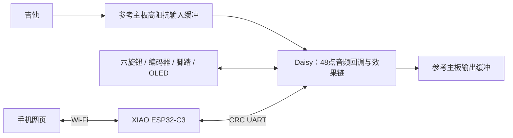

# 产品设计冻结：SeedFX v1

## 用途与范围

一台可独立演奏、可用手机编辑的吉他综合效果器。低成本通用外围、现有可靠音频主板和125B 面板尺寸、42mm 深度壳体优先；封面图案通过独立 SVG 图层替换。首版不依赖云端账号或手机 App。

制作数量固定为 **1 台**。组装、调试、修正与最终装壳使用同一套主控和主板，完成验收后作为最终成品。采购按单台项目的整单费用核算；工厂最低订单产生的余板留作维修备件。

| 项目 | 首版规格 |
|---|---|
| 音频主控 | Electro-Smith Daisy Seed Rev7，STM32H750，480MHz |
| 音频设置 | 48kHz，48 点/块；使用 Seed 内置 codec、SDRAM 与 QSPI |
| 模型 | 固定 C=3、23 层、1871 权重的 NAM A2 结构；一次一个活动模型 |
| 链路 | Gate、Compressor、Overdrive、NAM、EQ、Cab IR、Chorus、Delay、Reverb |
| EQ | 110Hz、900Hz、4kHz 三段 peaking EQ，±12dB |
| 箱体 | 两个 1024 点因果 FIR；关/开独立控制 |
| 延迟 | 40–1500ms，反馈上限 85%，支持 Tap Tempo |
| 混响 | 低开销四个带阻尼的梳状滤波器与两个全通扩散器，混合上限 60%，反馈参数受限 |
| 调音 | A4=440Hz，降采样后的主循环音高检测，调音时音频淡出静音 |
| 预设 | 16 槽，保存全部参数和六旋钮映射，双银行 CRC 校验 |
| 控制 | 六 B10K 旋钮，按压编码器，两 SPST 瞬时脚踏 |
| 本机显示 | 0.96 英寸、128×64、七针 SPI、SSD1306，20Hz 刷新 |
| 无线 | XIAO ESP32-C3，2.4GHz Wi-Fi AP，本地 HTTP 网页 |
| 主控间连接 | USART1，Daisy D13/D14，230400 8N1，3.3V 电平 |
| 电源 | 9V 中心负，建议隔离电源且额定至少 1A；无线单独降压 |
| 外形 | 66×121.5×42mm 设计模型，125B 系列；标准壳需核对实际内腔 |

## 架构与实时边界

音频回调拥有 DSP 参数与状态。主循环通过单生产者/单消费者队列更新参数。切换模型、IR 或结构开关时，先请求淡出；回调确认暂停后才加载和修改共享 DSP 状态。连续参数约 10ms 平滑，结构切换采用约 3ms 淡出和约 3ms 淡入，数字旁通和调音静音采用约 5ms 过渡。

同模型、同效果结构的预设直接以整组参数提交，不重新载入权重。跨模型解析稳态初始化只适用于本项目已验证的固定结构；不运行双模型交叉淡化。

IR 采用 CMSIS-DSP 48 点块 FIR，不增加额外块缓冲延迟；压缩增益目标与合唱正弦控制按 1ms 块计算，增益与延迟位置仍按样本插值。较大的延迟与混响缓冲位于外部 SDRAM；NAM 历史位于片上 D2 SRAM，热权重与工作区位于 DTCM。主程序从 SRAM 执行。

## 必须实测的设计目标

这些是验收目标，不是现有测量值：

- NAM + EQ + IR 的有线端到端延迟目标小于 5ms；分清模型额外 1ms 缓冲与转换器、DMA、IR 相位响应。
- 模型切换静音窗口目标小于 20ms；同模型预设应更快。记录至少 100 次切换的最大值和是否有明显爆音。
- 最坏音频回调低于 1ms，并争取至少 25% 余量；需要覆盖所有效果开启、最大反馈、模型切换、屏幕刷新和无线调参。
- 无线参数指令确认目标低于 150ms；页面状态轮询为 250ms，不能将显示刷新时间当音频延迟。
- 5m 范围手机控制稳定；无线断开不使音频停止或重置音色。

## 预设起点

P01–P05 依次使用五个模型；Ampeg 参考名称带 MD421 麦克风信息，P03 关闭额外箱体 IR。P06 合唱、P07 短延迟、P08 Lead 延迟、P09 Ambient、P10 过载起点、P11 Bass 起点、P12 压缩起点、P13 无 NAM/Cab 的基础链、P14 基础合唱、P15 基础延迟、P16 用户起点。

这些是调参起点，未做实机响度匹配和试听验收。未知捕获是否包含箱体的模型应按模型指南确认，避免重复箱体处理。
